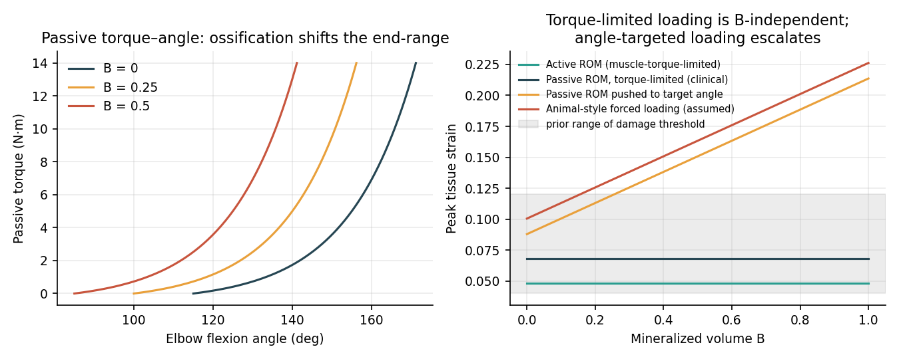
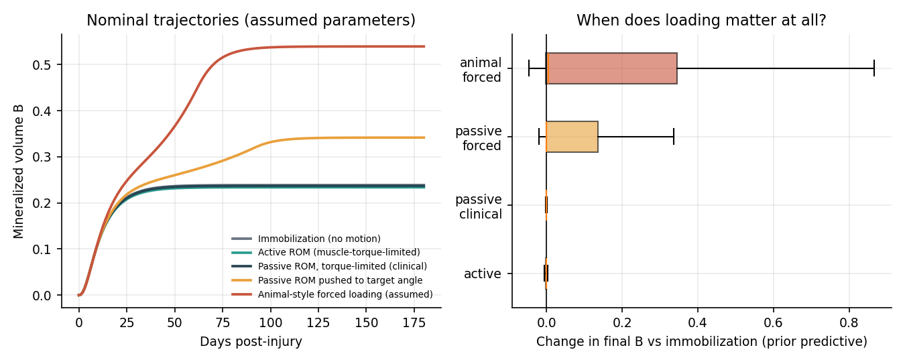
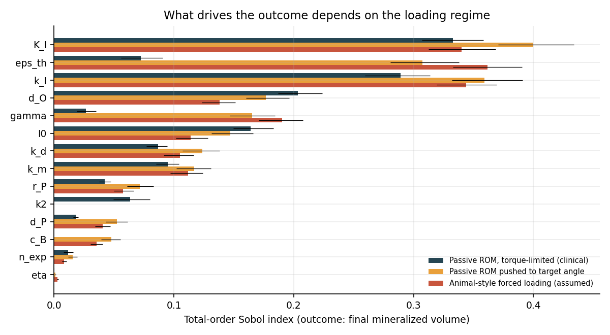
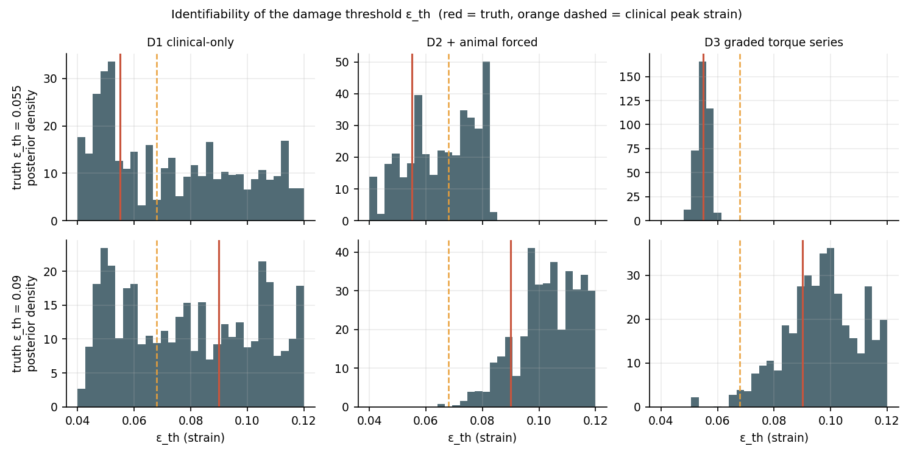

# HO Twin: a mechanobiology digital twin of heterotopic ossification

A layered simulation of **elbow heterotopic ossification (HO) under joint loading**, built to ask:
*what would it take to know whether the loading that caused HO in animal models transfers to clinical passive motion?*
It turns the category-error question from my thesis (animal force-loading vs clinical passive ROM) into something you can run.

**Author:** Bismah Zainab

> **Status: research demonstration, hypothesis-generating only.** Loading-regime protocols and the
> biological timing window carry literature provenance (`hotwin/evidence.py`). The ODE rate constants
> and the damage threshold `eps_th` remain illustrative assumptions. Calibration uses synthetic data.
> Nothing here is validated or clinical advice.

## Evidence base (v0.2)

`hotwin/evidence.py` grades every anchor `direct` / `scaled` / `conceptual`:

| Anchor | Value | Source | Mapping |
|---|---|---|---|
| Normal elbow flexion ROM | aROM 146 deg, pROM ~150 deg | Zwerus et al., *Shoulder & Elbow* 9(4), 2017 | conceptual |
| Functional arc | 30-130 deg | Sardelli et al. 2011 (via Physio-pedia) | direct |
| Mechanostat strain thresholds | MESm 1000-1500 uStr, MESp ~3000 uStr | Frost, *Anat Rec* 275A(4), 2003 | conceptual |
| HO onset | osteoid 1-2 wks; radiographic haze 4-6 wks | Casavant & Hastings, *J Hand Ther* 19(2), 2006 | scaled |
| HO maturation | 3-9 months | Casavant & Hastings, 2006 | direct |
| HO incidence | 3% simple dislocation; ~49% fractures | Thompson; Ilahi (reviewed in ScienceDirect HO overview) | direct |
| Animal-forced regime | immobilization + daily ~5 min forcible manipulation; HO in 2-5 wks | Michelsson & Rauschning, *Clin Orthop* 176:265, 1983 (PMID 6406124) | direct |
| Clinical CPM regime | 70 deg arc, 45 s cycle, 2 wks - no HO progression | van Susante et al., *Acta Orthop Scand* 67(4):450, 1996 | direct |

The Frost mechanostat numbers describe **bone** tissue; the model's `eps_th` is a soft-tissue strain,
so the link is conceptual only and flagged as such. This boundary is deliberate: it is exactly the gap
the identifiability analysis below quantifies.

## What is in it

| Layer | What it does | Code |
|---|---|---|
| Biology | ODE system: inflammatory signal -> progenitors -> osteogenic cells -> mineralized volume | `hotwin/biology.py` |
| Mechanics | Elbow torque-angle law; ossification shifts the end-range; strain-exceedance damage dose | `hotwin/mechanics.py` |
| Coupling | Damage dose feeds inflammation; angle-targeted loading escalates strain as bone forms | `hotwin/biology.py` |
| Evidence | Literature anchors with provenance grading | `hotwin/evidence.py` |
| Sensitivity | Sobol indices (Saltelli/Jansen), written from scratch, bootstrap CIs | `hotwin/sensitivity.py` |
| Inference | Differential-evolution MCMC (split-population), R-hat and ESS diagnostics, from scratch | `hotwin/calibration.py` |
| Transfer metric | P(clinical strain > threshold) and a dose ratio, from posterior samples | `hotwin/metrics.py` |

Dependencies: numpy, scipy, matplotlib only. Default simulation horizon is **180 days** (HO matures over
3-9 months); calibration uses day-120 snapshots, so the identifiability analysis is unchanged from v0.1.

## Results

**1. Loading matters only in some regimes.** Fraction of prior samples where a regime raises final mineralization by more than 0.05 vs immobilization:
active 1.7% - torque-limited clinical passive 3.8% - passive pushed to a target angle 29.2% - animal-style forced 37.9%.




**2. What drives the outcome depends on the regime.** For clinical torque-limited passive motion the damage threshold is not among the top drivers
(inflammatory kinetics dominate). For forced regimes the threshold `eps_th` becomes a top driver, and the leading one for animal-style loading.



**3. Identifiability of the damage threshold (synthetic data, two true thresholds).** Posterior 90% interval of `eps_th` (prior range 0.04 to 0.12; clinical peak strain 0.068):

| Design | True 0.055 | True 0.090 |
|---|---|---|
| D1 clinical-only (immobilized, active, passive) | 0.043 - 0.114 (no information) | 0.046 - 0.117 (no information) |
| D2 + animal-style forced loading | 0.047 - 0.082 (still straddles 0.068) | 0.084 - 0.119 (excludes 0.068) |
| D3 graded torque series | 0.051 - 0.058 (recovers truth) | 0.073 - 0.118 (weakly constrained) |

Take-aways: clinical-only data cannot identify the threshold; animal-style data can show clinical loading is below threshold **only if the threshold is high**; a graded loading series pins down a **low** threshold but is weak when the threshold is high (the posterior then runs into the prior bound).



Sampler diagnostics: R-hat <= 1.064 and ESS >= 231 in the five standard runs (12 chains x 1500 iterations).
The D3 low-threshold run needed a longer chain (16 chains x 3000 iterations) after a shorter run failed to
converge (R-hat 7.1); the converged run reports R-hat 1.013, ESS 1225, and only that one is used above.

## Reproduce

```bash
pip install -r requirements.txt
python -m unittest discover -s tests          # 13 tests
python scripts/run_all.py --stages mech,traj,sobol
python scripts/run_all.py --stages calib --runs 00,10,01,11,12   # ~100-200 s per run
python scripts/run_all.py --stages calib --runs 02 --iters 3000 --chains 16 --burn 1500  # D3 low threshold
python scripts/run_all.py --stages calibfig
```

Tests check: state bounds and monotonicity, RK4 step convergence, torque- vs angle-controlled strain behavior,
Sobol against the analytic Ishigami function, both MCMC samplers on Gaussian targets (including a 0.95-correlated ridge),
and the integrity of the literature evidence base.

## Limitations

- Biological rate constants (`k_I`, `r_P`, `d_P`, `k_d`, `K_I`, `d_O`, `k_m`), coupling gains (`gamma`, `eta`) and the damage threshold `eps_th` are illustrative assumptions; only regimes and timing carry literature provenance.
- One synthetic dataset per scenario; baseline rates `k_m`, `k_d` are fixed at truth during inference.
- A single lumped joint, no spatial HO growth, no immobilization-plus-necrosis pathway (the rabbit model's actual trigger), no patient heterogeneity, no pain or guarding model.
- The posterior for a high threshold is truncated by the prior upper bound.

## Roadmap

1. ~~Replace assumed priors with values extracted from the HO literature~~ - done for regimes/timing in v0.2; rate constants still open.
2. Pattern-oriented validation: encode the thesis's qualitative findings as constraints and sample the prior for the consistent region; add the immobilization-plus-necrosis pathway.
3. Joint inference over baseline biology and mechanics; multiple synthetic datasets per scenario.
4. Interactive viewer; link to the portfolio's decision-support tools as a mechanistic evidence level for a rule.
